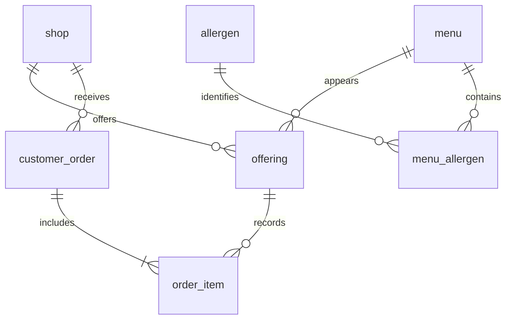

# 設計

## 依存関係

`Main → RestaurantCli → CatalogRepository / OrderService / AdminService → JDBC`という流れです。CLIは入力と表示、サービスは操作の整合性、DB層は接続とSQLを担当します。検索条件は位置に意味を持たせた整数リストではなく、`MenuSearch`として渡します。

検索だけのクラスを表示方法ごとに増やす構成から、条件を組み合わせる1つの検索へ変更しました。並び順のSQLはenumの定数だけから選びます。入力値はすべて`PreparedStatement`で束縛し、アレルゲンが0件なら`IN ()`を生成しません。

## データモデル

店舗ごとに異なる価格・在庫・限定区分は`offering`に置きます。メニューとアレルゲンは多対多です。主キー・外部キー・非NULL・範囲CHECK制約を定義し、アプリケーションの入力検査とは別にDBでも不整合を拒否します。

`order_item`には商品名と注文時単価を保存します。複合外部キーにより、注文と明細の店舗、および提供店舗の一致もDBで検査します。売上はこの明細から計算し、商品価格が後から変わっても過去の金額は変えません。金額は整数の円です。レシート合計には`long`、累積売上にはSQLのDECIMALと`BigDecimal`を使います。

## 注文の確定

1. 店舗ID、商品ID、数量、カート件数、除外IDの形式を検査する。
2. `READ_COMMITTED`のトランザクションを開始する。
3. 商品IDの昇順に提供行を`SELECT ... FOR UPDATE`でロックする。
4. その店舗での提供、在庫、除外アレルゲンを再確認する。
5. 注文を作成し、在庫を条件付きで減算して明細を保存する。
6. すべて成功した場合だけCOMMITする。SQL例外・業務上の拒否はROLLBACKする。

ユーザーが確認入力する間はDBのロックを保持しません。確定時の価格・在庫を読み直します。CLIは表示済みの商品IDだけを受け付け、サービス側でもアレルゲン除外を検査します。複数商品注文は一部成功にせず、1件でも失敗したら全体を取り消します。

ロック順の統一は競合を減らしますが、あらゆるデッドロックをなくす保証ではありません。DBエラー時には自動再試行をせず、結果確認を促します。通信切断がCOMMIT応答と重なった場合の結果不明や、操作を再起動した後の重複注文を解決する冪等キーは未実装です。

## 在庫の手動更新

確認時の`version`をUPDATE条件に含め、更新時に加算します。注文も同じバージョンを更新するため、表示後の注文や別管理者の変更を古い値で消しません。数量が一度変わって元に戻るABAケースも検出します。

## 登録

メニューIDは`MAX(id)+1`ではなくDBの自動採番です。メニューとアレルゲンの関連登録を1トランザクションにまとめます。店舗への提供は複合主キーで重複を拒否し、参照先の存在は外部キーでも検査します。

## 失敗時の動作

入力エラーは範囲や形式を示して再入力できます。EOFは注文未確定のまま終了します。DBリソースは`try-with-resources`で解放し、例外のスタックトレース・SQL・接続文字列を利用者へ出力しません。整合性制約以外のDBエラーはセッションを終了し、接続失敗時の無限再試行を避けます。

COMMIT結果が不明な通信障害では、自動で再注文しないでください。現版には注文一覧照会UI・監査基盤がないため、本番運用向けではありません。

## 規模と制約

商品カタログは小規模な授業用を想定しています。検索・集計はページングしておらず、販売ランキングは明細を集約します。大量データへの性能測定や集計の最適化は未実施です。カロリーは非負の整数kcalで、旧設計のDOUBLE値は自動変換しません。
